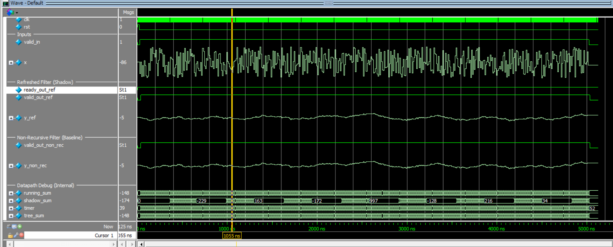
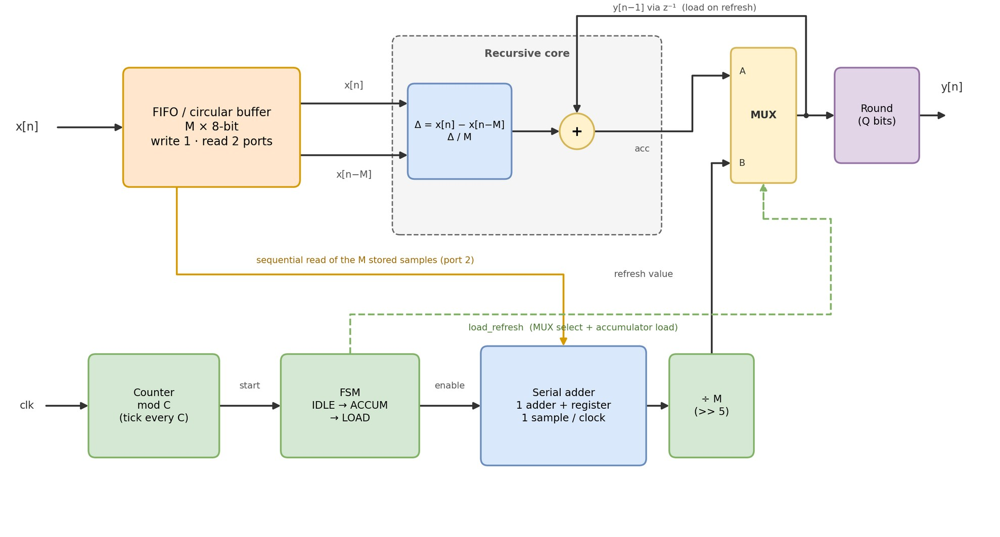
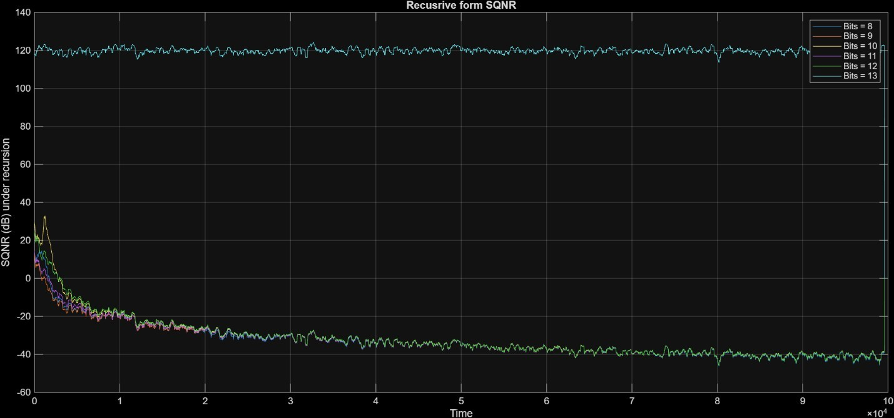
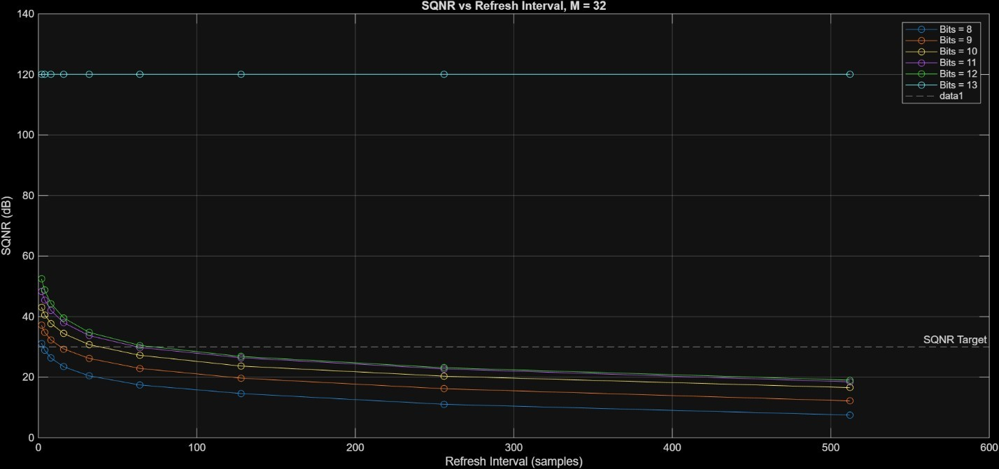
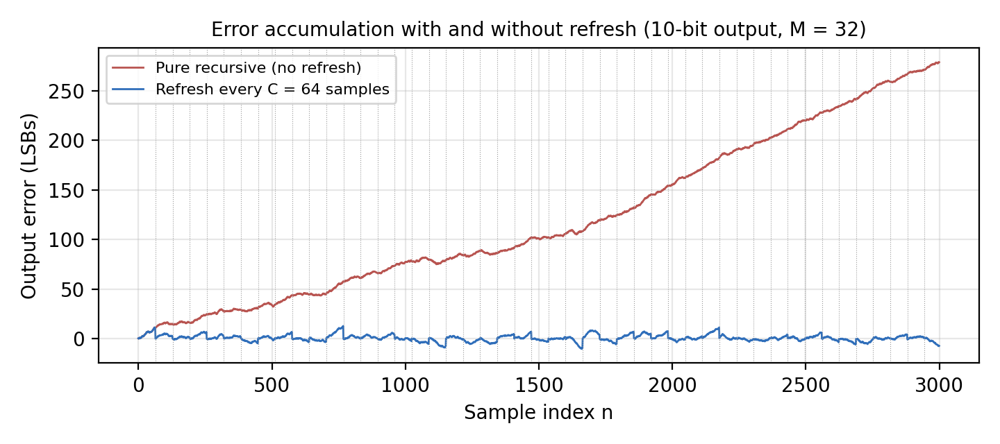

# Fixed-Point Moving-Average Filter: SQNR Study

A MATLAB simulation study of a 32-sample moving-average filter. It compares a direct sum, a low-cost recursive implementation, and a recursive implementation periodically corrected by a counter-triggered refresh.

The central design question is: **How can the filter keep its hardware cost low without allowing fixed-point error to grow until it overwhelms the signal?** The simulation answer is to use the recursive update between refreshes, then periodically recompute the current window sum. The refresh interval trades SQNR against correction activity and hardware cost.

> This repository includes the MATLAB study, functional Verilog RTL, a self-checking testbench, and supplied ModelSim waveform evidence. The RTL has not been independently rerun or synthesized as part of this repository update.

## RTL implementation and results

The `rtl/` directory contains two implementations of the 32-sample moving-average filter. `non_recursive_filter.v` is the direct-form baseline: it stores the sample history and sums the current window. `refreshed_filter.v` maintains a running sum and periodically replaces it using a shadow sum accumulated over the current window. Defaults are `M=32`, 8-bit signed input, 10-bit output, and `REFRESH=64`. The module keeps `ready_out` asserted and does not apply backpressure.

`tb_moving_average.v` supplies 500 random signed samples to both modules, compares their outputs, and reports a final mismatch count. In ModelSim or Questa, run `do run.do` from the `rtl/` directory. The script compiles the RTL and testbench, loads `wave.do`, and runs the simulation. The supplied waveform below shows the refreshed and direct-form output traces tracking closely during the displayed interval. The source folder had no transcript, so the screenshot does not prove the final testbench verdict. The waveform database is available at [`results/vsim.wlf`](results/vsim.wlf).



The supplied synthesis reports are in `synthesis/`; their power values are low-effort estimates because switching activity was not annotated. See the comparison and caveats in [synthesis/README.md](synthesis/README.md).

## Problem

For a window of length \(M=32\), the ideal output is the average of the latest 32 input samples. The input samples are signed 8-bit integers, normalized by 128. The output is rounded to a selected fixed-point grid with 8 to 13 total bits.

Two common implementations have opposing weaknesses:

- **Direct (non-recursive) sum:** recomputes all 32 taps on every output. Its rounding error does not accumulate, but the parallel implementation needs 31 adders and a 31-sample history delay line with many taps read at once.
- **Recursive update:** uses the previous output plus the newest sample minus the oldest sample, divided by 32. It needs much less arithmetic per sample, but rounding is inside a feedback loop. The accumulated error can drift, so its SQNR collapses over a long run.

For this study, quality is measured against the unquantized direct moving average:

\[
\mathrm{SQNR}=10\log_{10}\left(\frac{P_{signal}}{P_{error}}\right),\qquad
P_{signal}=\operatorname{mean}(y_{ideal}^2),\quad
P_{error}=\operatorname{mean}((y-y_{ideal})^2).
\]

The target is a whole-run average SQNR of at least 30 dB.

## Proposed solution: periodic refresh

The recursive path remains the normal output path. Every \(C\) samples, a counter starts a refresh that recalculates the average of the current 32-sample window and reloads the recursive state. This clears the accumulated feedback error. A smaller \(C\) bounds error more often and improves SQNR; a larger \(C\) reduces refresh activity but allows more error to build between corrections.



The report proposes resource folding for the refresh: one serial adder accumulates the 32 samples over 32 cycles, instead of rebuilding a 31-adder tree. A small FSM controls the operation.

### Hardware timing caveat

The MATLAB model applies a refresh instantly. A real serial refresh takes 32 cycles, so it cannot run as a background operation when \(C<32\). At \(C=32\), it is continuously busy; at \(C=64\), it is busy about half the time. To keep output streaming during a refresh, the implementation must account for the fact that the serial sum is based on an older window when it finishes. The report suggests either stalling input or maintaining a shadow accumulator for the increments that arrive during the serial sum. That timing correction is not modeled or implemented here.

## Results

The script uses one 100,000-sample uniformly random input sequence per run. The table summarizes the report's whole-run refresh sweep; the refresh-count column is the count reported for that run.

| Output bits | Largest tested \(C\) meeting 30 dB | Refresh SQNR | Refreshes in run |
|---:|---:|---:|---:|
| 8 | 2 | 31.18 dB | 49,984 |
| 9 | 8 | 32.29 dB | 12,496 |
| 10 | 32 | 30.79 dB | 3,124 |
| 11 | 32 | 33.77 dB | 3,124 |
| 12 | 64 | 30.53 dB | 1,562 |
| 13 | Not meaningful | approximately 120 dB floor | depends on \(C\) |

The 13-bit case is effectively exact for the modeled input grid, but the displayed value is **not a measured 120 dB performance result**. The script clamps error power to \(10^{-14}\) before the logarithm; when the modeled error is zero, this clamp produces a finite numerical floor near 120 dB.

The report's baseline comparison also shows the key failure mode: direct summation meets the target at all tested non-exact widths (8 bits gives 32.24 dB), while the pure recursive case averages roughly -32 dB for 8 to 12 bits over the run. Periodic refresh bounds that accumulated error. Since the margins for 10 bits at \(C=32\) and 12 bits at \(C=64\) are under 1 dB, the report recommends rerunning with multiple random seeds before treating those margins as robust.







### Practical interpretation

- **12 bits, \(C=64\):** meets the target in the reported run with a 50% serial-adder duty cycle, but has only 0.53 dB margin.
- **12 bits, \(C=32\):** the report gives 34.82 dB, providing more margin, but a single serial adder is busy every cycle.
- **13 bits:** does not demonstrate a useful refresh tradeoff because the modeled arithmetic is exact and the metric hits its floor.

Choose the interval from the actual system's throughput, area, SQNR margin, and worst-case requirements. The current results are average-SQNR simulation results, not a worst-case guarantee.

## Project contents

```text
.
├── time_dependant_refreshed_moving_avg_filter.m  # MATLAB simulation and plots
├── MA_Filter_SQNR_Report.pdf                     # Full study, diagrams, tables, and caveats
└── figures/                                       # Extracted report figures (PNG)
```

The figures folder contains extracted architecture diagrams, SQNR plots, and histograms from the report. The report PDF remains in the repository as the source for the extracted figures and the complete methodology.

## Run the simulation

1. Open `time_dependant_refreshed_moving_avg_filter.m` in MATLAB.
2. Run the script. It generates baseline and refresh SQNR plots, prints the counter sweep and selected refresh points, and produces example waveform plots.

The main parameters are defined near the top of the script:

- `M = 32`: moving-average window length.
- `N = 100000`: number of random input samples.
- `T_power = 7:12`: fractional output precision; reported total width is `T_power + 1` (8 to 13 bits).
- `counter_sweep = [2, 4, 8, 16, 32, 64, 128, 256, 512]`: tested refresh intervals.
- `SQNR_target = 30`: target used to choose the largest qualifying interval.

The input is randomly generated with `randi([-128, 127], 1, 100000)`. No random seed is fixed, so individual runs can produce slightly different values. The PDF records the run used for its tables and explains additional measurement caveats.

## Figures

- [Direct-form architecture](figures/01-nonrecursive-architecture.png)
- [Direct-form adder tree](figures/02-nonrecursive-adder-tree.png)
- [Direct-form SQNR](figures/03-nonrecursive-sqnr.png)
- [Recursive architecture](figures/04-recursive-architecture.png)
- [Recursive error feedback model](figures/05-recursive-error-feedback.png)
- [Recursive SQNR drift](figures/06-recursive-sqnr-drift.png)
- [Recursive SQNR histogram](figures/07-recursive-sqnr-histogram.png)
- [Refresh error comparison](figures/08-refresh-bounds-error.png)
- [Refresh architecture](figures/09-refresh-system-architecture.png)

- [Refresh finite-state machine](figures/10-refresh-fsm.png)

- [Refresh SQNR over time](figures/11-refresh-sqnr-time-series.png)
- [SQNR versus refresh interval](figures/12-sqnr-vs-refresh-interval.png)
- [Refreshed SQNR histogram](figures/13-refresh-sqnr-histogram.png)

## Synthesis comparison

The supplied Design Compiler reports show the refreshed implementation with 26.71% lower mapped area and 45.49% lower estimated dynamic power than the direct-form baseline. The synthesis paths are also shallower (3 logic levels vs 20). These power numbers are low-effort estimates with unannotated activity, not measured silicon values. See the [full metric comparison and report files](synthesis/README.md).

## Reference

See [the full report](MA_Filter_SQNR_Report.pdf) for equations, architecture diagrams, the complete counter sweep, MATLAB console output, and the limitations of the simulation.
